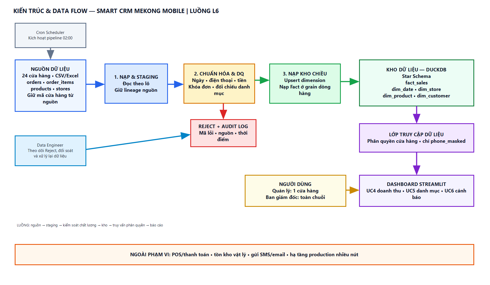
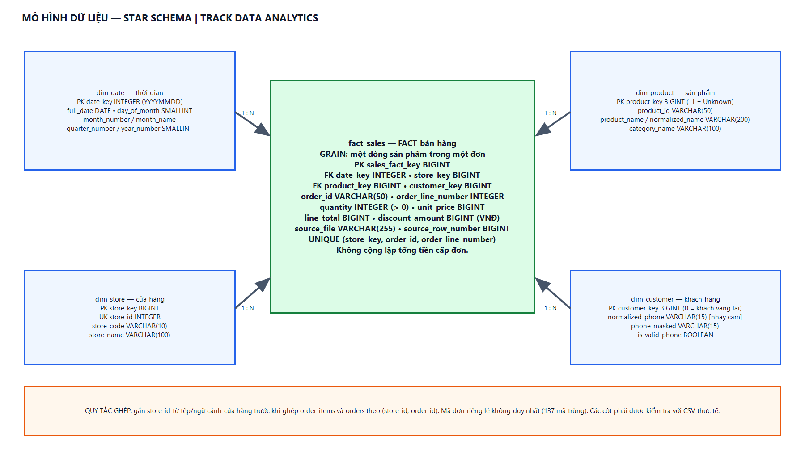
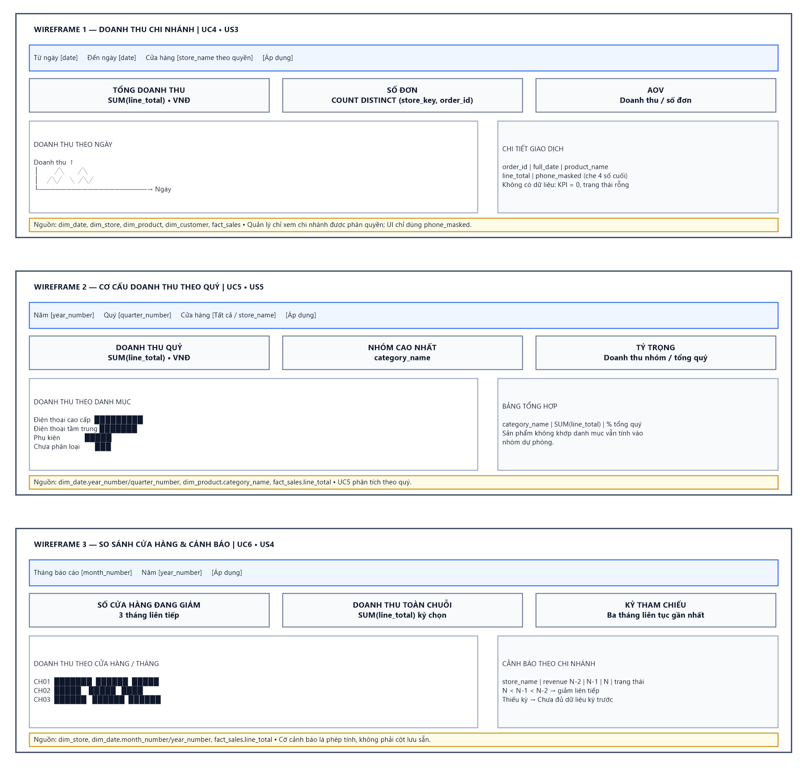

# Smart CRM Mekong Mobile – Phân hệ Luồng L6: Kho dữ liệu bán hàng & Báo cáo doanh thu

**Dự án học phần:** Chuyên đề tốt nghiệp 1 – Học kỳ 1, Năm học 2026 – 2027  
**Sinh viên thực hiện:** Mai Tuấn Kiệt  
**MSSV:** 2374802010259  
**Track:** Data Analytics (DA)  
**Luồng nghiệp vụ:** L6 – Kho dữ liệu bán hàng và báo cáo doanh thu  
**Giảng viên phụ trách:** TS. Nguyễn Trí Hải / ThS. Nguyễn Minh Tân / ThS. Trần Công Thanh  

---

## 1. Giới thiệu tổng quan và Mục tiêu bài toán
Hệ thống giải quyết bài toán hợp nhất, chuẩn hóa và phân tích dữ liệu bán hàng phân tán từ 24 chi nhánh của chuỗi bán lẻ thiết bị Mekong Mobile. Quy trình bao gồm:
1. Thu thập dữ liệu đơn hàng định kỳ từ 24 tệp CSV/Excel (~26.000 giao dịch).
2. Xử lý các vấn đề chất lượng dữ liệu: lỗi định dạng ngày tháng, trùng lặp mã đơn giữa các chi nhánh, sai lệch số tiền, lỗi dữ liệu khách hàng.
3. Nạp dữ liệu vào mô hình kho dữ liệu đa chiều Star Schema (DuckDB/PostgreSQL).
4. Xây dựng Dashboard phân tích doanh thu trực quan bằng Streamlit phục vụ Quản lý cửa hàng và Ban giám đốc chuỗi.

---

## 2. Cấu trúc thư mục dự án (Repository Structure)

```text
.
├── BAO_CAO_BUOI_4.md          # Báo cáo kết quả thực hành Buổi 4 (12 mục điền đủ)
├── BAO_CAO_BUOI_5.md          # Thiết kế kiến trúc, mô hình dữ liệu và wireframe Buổi 5
├── README.md                  # Hướng dẫn tổng quan kho mã nguồn
├── docs/                      # Thư mục hồ sơ phân tích và thiết kế
│   ├── srs.md                 # Bản đặc tả yêu cầu phần mềm rút gọn (SRS 6 mục)
│   ├── data-requirements.md   # Đặc tả yêu cầu dữ liệu chuyên ngành DA (Mẫu track)
│   ├── architecture.drawio    # Sơ đồ kiến trúc và luồng dữ liệu L6
│   ├── architecture.png      # Ảnh xem nhanh sơ đồ kiến trúc
│   ├── erd.drawio             # Mô hình Star Schema của track DA
│   ├── erd.png                 # Ảnh xem nhanh mô hình Star Schema
│   ├── wireframe.drawio       # Nguồn wireframe 3 màn hình dashboard
│   ├── wireframe.png          # Bản xem nhanh 3 wireframe
│   ├── usecase.drawio         # File nguồn sơ đồ Use Case Diagram (Draw.io XML)
│   ├── usecase-specification.md # Đặc tả chi tiết Use Case UC2 & UC4 (Luồng chính & Ngoại lệ)
│   └── ai-disclosure.md       # Bảng khai báo minh bạch công cụ AI và cam kết
├── src/                       # Mã nguồn pipeline ETL và Dashboard (Phát triển ở BT2)
└── tests/                     # Kịch bản kiểm thử chất lượng dữ liệu (Phát triển ở BT3)
```

### Hồ sơ thiết kế Buổi 5

Mở [BAO_CAO_BUOI_5.md](BAO_CAO_BUOI_5.md) để xem các quyết định kiến trúc, grain và điểm cần xác nhận. Tệp `.drawio` là nguồn sơ đồ có thể chỉnh sửa bằng diagrams.net/draw.io; GitHub không hiển thị sơ đồ từ XML nên repo kèm các ảnh PNG xem nhanh: [kiến trúc](docs/architecture.png), [Star Schema](docs/erd.png) và [ba wireframe](docs/wireframe.png).

### Xem nhanh thiết kế







Buổi 5 hoàn thiện tài liệu thiết kế BT1; phần mã ETL và dashboard thuộc BT2.

---

## 3. Các lưu ý quan trọng đã khắc phục từ phản hồi BT1
- **Đúng phạm vi case study:** Bám sát bài toán Luồng L6 của chuỗi Mekong Mobile (không làm nhầm sang giỏ hàng/thương mại điện tử khác).
- **Quy tắc nghiệp vụ:** Trích dẫn chuẩn xác các quy tắc Bảng 9.1 và logic tính toán bán lẻ thiết bị di động.
- **Sơ đồ Use Case:** Có đầy đủ ranh giới hệ thống, 4 tác nhân (bao gồm actor hệ thống Cron Timer), 6 use case, quan hệ `<<include>>`, `<<extend>>`, bảng chú thích (Legend) và khung phạm vi loại trừ (Out of Scope).
- **Bảng truy vết yêu cầu (Traceability Matrix):** Đầy đủ 100%, tuyệt đối không có ô trống.
- **Yêu cầu phi chức năng (NFR):** Toàn bộ 4 NFR đều có ngưỡng số đo được cụ thể (thời gian dưới 45 giây, phản hồi dashboard dưới 2.5 giây, độ chính xác null = 0%, tính nhất quán >= 99.5%).
- **Liêm chính học thuật:** Bảng khai báo AI có dòng cam kết đầy đủ thông tin Họ tên, MSSV, ngày tháng.
